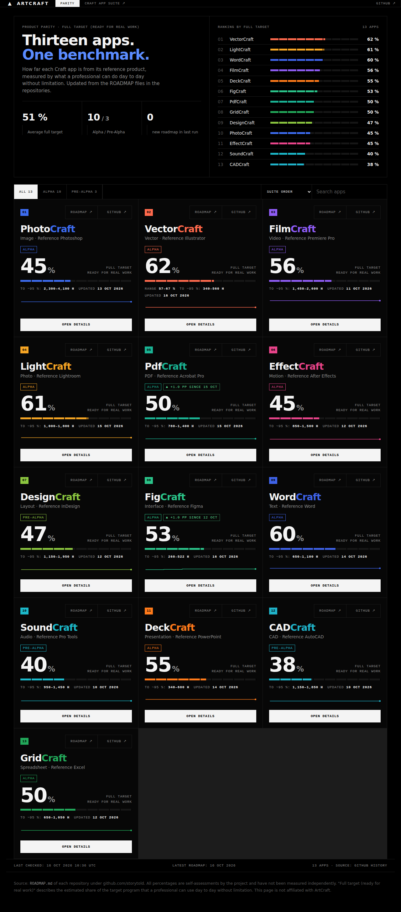
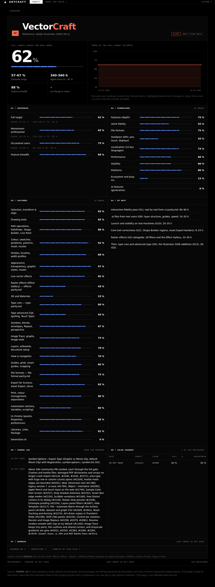

<div align="center">

# ArtCraft Parity Tracker

**How close are the ArtCraft Craft apps to the products they replace?**

A live dashboard that tracks the product parity of all 13 Craft apps against their reference products,
built from the `ROADMAP.md` files in the [storytold](https://github.com/storytold) repositories.

[](https://github.com/KollektivHannemann/artcraft-paritaet/actions/workflows/update.yml)
[](https://kollektivhannemann.github.io/artcraft-paritaet/)

</div>



## What it shows

- **Full target (ready for real work)** for every app: the project's estimate of how much of the target program a
  professional can use day to day without limitation. This is the main metric.
- **Ranking and filters** by stage, with search and sorting by suite order, full target, feature breadth, or last update.
- **Detail view** per app: trend over every roadmap revision, audience values (full, mainstream, occasional users),
  dimensions, feature areas, next steps, the project's own change log, and a table of value changes.
- **Automatic updates:** a GitHub Action checks the repositories every 6 hours and commits new roadmap revisions.
  Apps with a new roadmap since the last run are flagged on the dashboard.



## Current snapshot

Values from the roadmap files as of 16 Oct 2026. The [live dashboard](https://kollektivhannemann.github.io/artcraft-paritaet/)
always shows the latest state.

| # | App | Reference | Stage | Full target | Range | Hours to ~95 % |
|---|---|---|---|---|---|---|
| 1 | VectorCraft | Illustrator | Alpha | **62 %** | 57–67 % | 340–560 h |
| 2 | LightCraft | Lightroom | Alpha | **61 %** | – | 1,000–1,800 h |
| 3 | WordCraft | Word | Alpha | **60 %** | – | 650–1,100 h |
| 4 | FilmCraft | Premiere Pro | Alpha | **56 %** | – | 1,450–2,600 h |
| 5 | DeckCraft | PowerPoint | Alpha | **55 %** | – | 340–600 h |
| 6 | FigCraft | Figma | Alpha | **53 %** | – | 268–522 h |
| 7 | PdfCraft | Acrobat Pro | Alpha | **50 %** | – | 780–1,400 h |
| 8 | GridCraft | Excel | Alpha | **50 %** | – | 650–1,050 h |
| 9 | DesignCraft | InDesign | Pre-Alpha | **47 %** | – | 1,150–1,950 h |
| 10 | PhotoCraft | Photoshop | Alpha | **45 %** | – | 2,300–4,100 h |
| 11 | EffectCraft | After Effects | Alpha | **45 %** | – | 850–1,500 h |
| 12 | SoundCraft | Pro Tools | Pre-Alpha | **40 %** | – | 950–1,450 h |
| 13 | CADCraft | AutoCAD | Pre-Alpha | **38 %** | – | 1,150–1,850 h |

Average full target across all apps: **51 %**. Values are the projects' own self-assessments, not independent measurements.

## The metric

"Full target (ready for real work)" is the share of the target program that a professional can use day to day
without limitation, as estimated in each project's `ROADMAP.md`. The dashboard shows it together with the estimate
range and the hours until the project reaches ~95 %. Each project's roadmap explains its own method.

## How it works

1. `scripts/update.py` clones each repository as a partial clone (commits and trees only, no file contents).
   It does not use the GitHub API, so there are no rate limits.
2. Every commit that changed `ROADMAP.md` is read. New commits are parsed and appended to `data/history/<app>.json`.
   Commits that contain no full-target value are remembered in `data/state.json` and not parsed again.
3. `scripts/roadmap_parser.py` maps the table labels of each roadmap (for example "Full target (ready for real work)")
   to metrics. It does not depend on line numbers, so it tolerates formatting differences between apps.
4. The results are written to `data/overview.json` and `data/apps/<app>.json`. `index.html` reads these files.
   It is a plain HTML, CSS and JavaScript page with no build step.

## Automatic discovery of new apps

Every run checks the public repositories of the GitHub account for new Craft apps:

- A repository is **added automatically** if it is not yet tracked, is not a fork or archived, has a `ROADMAP.md`,
  and that roadmap contains a full-target row. Repositories with a roadmap of a different kind (for example product
  goals) are skipped.
- The new app is appended to `apps.json` and tracked from then on. Its `added` date is recorded.
- For 14 days after discovery, the dashboard shows a banner on the overview page and a *New app* tag on the card.
- Repositories listed under `ignored_repos` in `apps.json` are never added. The account's `artcraft` and `craft-launcher`
  repositories are ignored by default.

Discovery needs the GitHub API. In GitHub Actions, the built-in token is passed automatically.

## Repository structure

| Path | Content |
|---|---|
| `index.html` | The dashboard: overview, ranking and detail view |
| `apps.json` | Tracked apps (reference product, category, color, suite order) and `ignored_repos` |
| `scripts/update.py` | Discovers new apps, checks roadmap revisions and writes the data files |
| `scripts/roadmap_parser.py` | Parses a `ROADMAP.md` into metrics, dimensions, features and the change log |
| `data/overview.json` | Data for the overview page |
| `data/apps/<app>.json` | Current state and history per app |
| `data/history/<app>.json` | One entry per roadmap revision from the git history |
| `data/state.json` | Commits without a full-target value, so they are not processed again |
| `.github/workflows/update.yml` | Scheduled update (every 6 hours) and commit of changed data |
| `docs/` | Screenshots used in this README |

## Run locally

```bash
# once: build the full history (takes a few minutes)
python3 scripts/update.py --backfill 500

# regular update: only new commits are processed
python3 scripts/update.py

# view the dashboard (fetch() needs a web server, not file://)
python3 -m http.server 8000
# then open http://localhost:8000
```

Requirements: Python 3.10 or newer and Git.

## Publish with GitHub Pages

1. Push this repository to GitHub.
2. Under *Settings → Pages*, set the source to *Deploy from a branch*, branch `main`, folder `/ (root)`.
3. Under *Settings → Actions → General → Workflow permissions*, choose *Read and write permissions*, so the action can
   commit data.
4. Run *Actions → Update roadmap parity → Run workflow* once. After that, it runs on its own.

A ready-made script for the GitHub CLI is included in the project archive as `setup-github.sh`.

## Limitations

- The parser relies on table labels. If a roadmap renames the full-target row, the dashboard shows a notice instead of
  silently dropping the value.
- The history starts with the first commit that contains `ROADMAP.md`. Earlier versions do not exist.
- Several revisions on the same day appear as separate points, because each commit is documented.
- The values are the projects' own estimates and can change a lot when a project changes its method.

## Disclaimer

This is an independent, unofficial project. It is not affiliated with or endorsed by ArtCraft or Storyteller.ai.
Product names such as Photoshop, Illustrator, Premiere Pro, Lightroom, Acrobat, After Effects, InDesign, Figma, Word,
PowerPoint, Excel, AutoCAD and Pro Tools are trademarks of their respective owners. The dashboard uses no ArtCraft
logos or icons.
